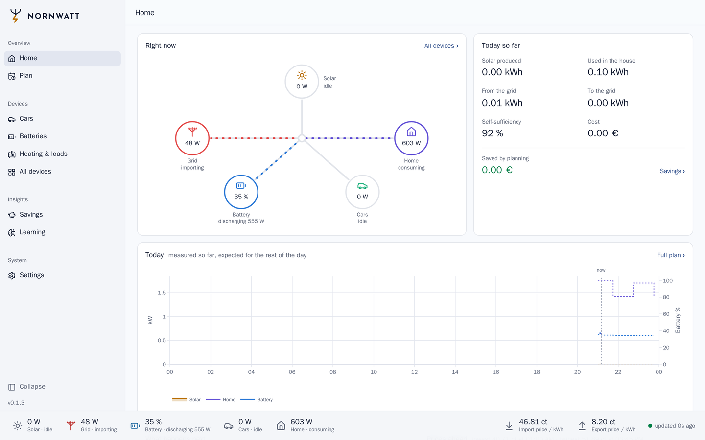

<p align="center">
  <picture>
    <source media="(prefers-color-scheme: dark)" srcset="branding/nornwatt-logo-on-dark.svg">
    
  </picture>
</p>

<p align="center">
  Open-source, vendor-neutral energy management for your home.<br>
  Plans your battery, car and heating around solar, prices and your household, and controls them.
</p>

<p align="center">
  <a href="https://nornwatt.com"><b>nornwatt.com</b></a> ·
  <a href="https://nornwatt.com/docs/getting-started/installation/">Install</a> ·
  <a href="https://nornwatt.com/docs/">Documentation</a> ·
  <a href="https://nornwatt.com/docs/devices/">Supported devices</a>
</p>

<picture>
  <source media="(prefers-color-scheme: dark)" srcset="docs/images/home-dark.png">
  
</picture>

## What it is

Nornwatt is an energy manager for a home with solar panels, a battery, an electric car, a heat pump or other large
loads. It runs on your own hardware next to Home Assistant.

- **Plans ahead.** Every 15 minutes an optimizer plans the coming hours and days from price, solar and consumption
  forecasts.
- **Controls your devices, or only watches.** Each device starts in observe mode and is handed over when you are
  ready. If Nornwatt stops, every device goes back to its own logic.
- **Works with what you have.** Anything Home Assistant can read or command, plus direct support for SMA (Modbus),
  Zendure, openWB, Tasmota, Tibber and ENTSO-E prices.
- **Learns your house** and **shows what it saves** against a simulated house without planning.

The name comes from the three Norns of Norse myth, who spin the threads of past, present and future: Nornwatt
learns from what has been, measures what is, and plans what will be.

**To install and use Nornwatt, go to [nornwatt.com](https://nornwatt.com).** This repository is the source code.

## How it is built

| Part | Technology |
|---|---|
| Core | Python 3.14, `asyncio`, Pydantic. One process: an event bus, a planner and a control loop. |
| Optimizer | A mixed-integer linear program (PuLP with the HiGHS solver) over the coming hours and days |
| Devices, tariffs, forecasts | Plugins in `src/nornwatt/plugins/`, each with a schema that also drives the config UI |
| Web UI and API | FastAPI serving a Vue 3 app (Vite, Tailwind CSS, Plotly), a REST API and a read-only MCP endpoint |
| Storage | SQLite for history, plans and learned models. The configuration is one `config.yaml`. |
| Home Assistant | REST and websocket API for reading and commanding, MQTT discovery for Nornwatt's own entities |
| Delivery | A container image, published as a Home Assistant add-on through [CyberDNS/hassio-addons-repository](https://github.com/CyberDNS/hassio-addons-repository) |

More: [VISION.md](VISION.md) · [ARCHITECTURE.md](ARCHITECTURE.md) · [DOMAIN_MODEL.md](DOMAIN_MODEL.md) ·
[ROADMAP.md](ROADMAP.md) · [RELEASE.md](RELEASE.md)

## Development

```bash
uv sync --extra dev
uv run pytest
```

Running the tests and building the web UI: [docs/development.md](docs/development.md). The website and user
documentation are in [CyberDNS/nornwatt.com](https://github.com/CyberDNS/nornwatt.com).

## Support

- **Something doesn't work?** Open a [problem report](https://github.com/CyberDNS/nornwatt/issues/new?template=bug_report.yml).
- **Your device isn't supported yet?** Open a [device request](https://github.com/CyberDNS/nornwatt/issues/new?template=device_request.yml).
- **Questions and ideas:** [GitHub Discussions](https://github.com/CyberDNS/nornwatt/discussions).

Please don't post passwords, tokens or IP addresses in issues: they are public.

## License

Nornwatt is licensed under the [Apache License 2.0](LICENSE).

The name "Nornwatt" and the logo (see [branding](branding/)) are not covered by that
license. You may use them to refer to this project; a fork or a product built on Nornwatt
needs its own name and logo.
